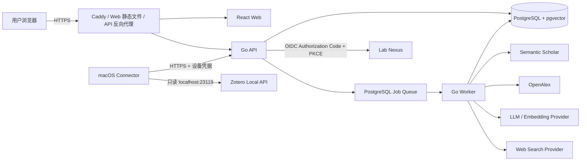
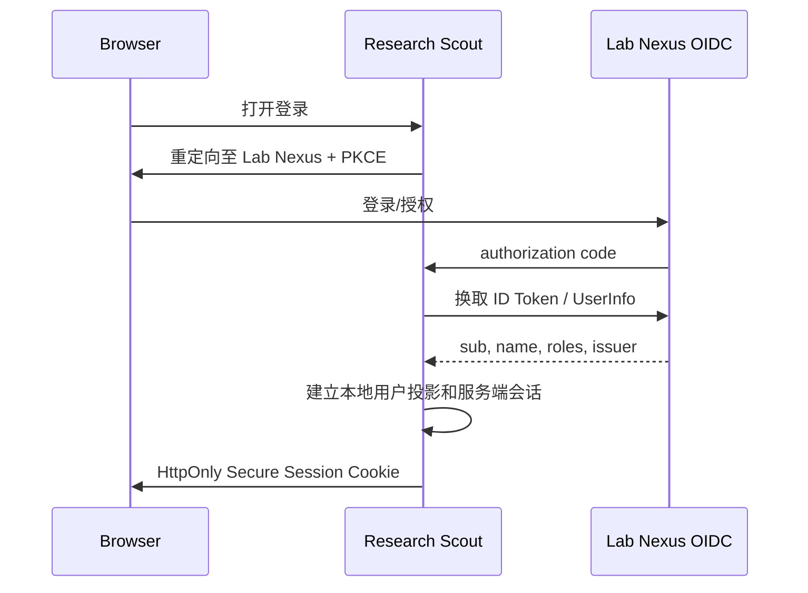

# Research Scout 技术方案设计：技术栈与系统架构

| 项目 | 内容 |
|---|---|
| 文档版本 | v0.1 |
| 状态 | 技术方向建议，待评审 |
| 日期 | 2026-10-16 |
| 关联 PRD | [`docs/prd/2026-10-16-zotero-research-assistant-prd.md`](../prd/2026-10-16-zotero-research-assistant-prd.md) |
| 目标 | 确定 v1 的技术栈大方向、系统边界和部署形态，为原型与实现排期提供基线 |
| 非范围 | 具体 HTTP 请求体、完整数据库字段、供应商最终合同和 UI 视觉规范 |

---

## 1. 决策摘要

### 1.1 一句话技术定义

Research Scout v1 采用 **Go 模块化单体 + PostgreSQL/pgvector + React/Vite Web + 原生 SwiftUI macOS Connector**，通过 Lab Nexus 联邦身份登录，在单台 Linux 主机上以 Docker Compose 部署；Zotero Local API 只提供派生全文，原始 PDF 永不进入服务端。

### 1.2 建议技术栈

| 层 | 推荐选型 | 选择理由 |
|---|---|---|
| 仓库组织 | 单仓库、多交付物 | Web、API、Connector、契约和部署配置需要同步演进，v1 不需要拆仓 |
| Web | React 19 + TypeScript + Vite + React Router 7 | 与 Lab Nexus 正式前端一致，适合登录后工作台和复杂异步状态 |
| Web 数据层 | TanStack Query + 原生 fetch；Zod 校验边界数据 | 服务端状态、缓存、重试和流式任务状态清晰，不引入 Redux |
| UI | Tailwind CSS v4 + shadcn/ui（Radix 基座） | 与 Lab Nexus 设计体系一致，组件源码可维护 |
| API | Go 1.25 + Gin | 与 Lab Nexus 技术栈一致；适合并发同步、任务编排和单二进制部署 |
| 数据访问 | pgx/v5 + sqlc | 检索、过滤、向量查询和租户隔离需要显式 SQL，避免把关键查询绑死在 ORM |
| 迁移 | Goose | 版本化、可审计，和 Go 单仓协作简单 |
| 主数据库 | PostgreSQL 16 + pgvector | 事务、全文、向量、任务状态和审计集中在一个可靠存储中 |
| 检索 | PostgreSQL FTS + pgvector HNSW + RRF + reranker adapter | v1 规模不需要独立搜索引擎或向量数据库 |
| 后台任务 | 同一 Go 代码库的 worker 进程；PostgreSQL-backed durable queue（首选 River） | 任务与业务数据同事务，减少 Redis/Kafka 运维面 |
| 流式交互 | HTTP REST + Server-Sent Events（SSE） | 问答和同步进度是单向流；比 WebSocket 简单、可穿透常见代理 |
| 接口契约 | OpenAPI 3.1 + 单独 SSE 事件契约 | 同时服务 Web、Connector 和测试；契约先行，减少跨端漂移 |
| 身份认证 | Lab Nexus OIDC Authorization Code + PKCE；Research Scout 自己维持会话 | 不共享密码、不直连 Lab Nexus 数据库、不跨应用复用长期 JWT |
| Connector | Swift 6 + SwiftUI + URLSession + Keychain + Sparkle | 原生 macOS 体积小、签名/公证/自动更新路径成熟，最适合只读 Local API |
| LLM/Embedding | Provider adapter；默认 OpenAI-compatible 接口，国内部署优先评估 DashScope/Qwen | 模型迭代快，必须把供应商和模型版本从领域模型中解耦 |
| Agent 编排 | Go 内实现有界状态机，不引入 LangChain/LlamaIndex 作为核心运行时 | 工具权限、步数、成本和证据链必须可预测、可测试 |
| 部署 | 单 VM + Docker Compose + Caddy；Web 静态文件同域提供 | 3–5 人试点无需 Kubernetes；备份、升级和排障成本最低 |
| 可观测性 | `log/slog` JSON + Prometheus 指标 + OpenTelemetry trace | 能追踪同步、检索、外部调用和生成链路，同时不记录私人全文 |
| 测试 | Go test + testcontainers + Playwright + XCTest + 检索 golden set | 覆盖 API、真实 Postgres、Web、Connector 和证据质量 |

### 1.3 已被否决的替代方向

| 替代方案 | 不采用原因 |
|---|---|
| 微服务 / Kubernetes | v1 只有 3–5 名用户，跨服务事务、部署和排障成本远高于收益 |
| 独立 Qdrant/Milvus | 删除一致性、权限过滤和事务边界更复杂；pgvector 足够支撑试点 |
| Elasticsearch/OpenSearch | 当前规模和检索需求不需要额外有状态服务 |
| Redis/Kafka 作为任务队列 | PostgreSQL 可提供足够的持久任务队列能力，减少一套生产依赖 |
| Next.js | 产品是登录后工作台，无 SEO/SSR 刚需；Vite 与 Lab Nexus 前端更一致 |
| Electron Connector | 资源占用和签名链路更复杂；v1 仅 macOS，SwiftUI 更合适 |
| 直接把 Lab Nexus JWT 给 Research Scout | 跨域会话、权限爆炸半径、设备凭据和撤权都无法清晰治理 |
| 直接把论文摘要作为中央语料 | 已被产品决策淘汰；个人 Zotero 全文才是首要证据层 |
| 自由 ReAct/无限 Agent 循环 | 成本、时延、工具越权和不可复现性不可接受 |
| 自行抓取全文 PDF | 法务、解析、存储和版权风险高；Local API 已能提供 Zotero 的派生全文 |

---

## 2. 现有事实与设计约束

### 2.1 Lab Nexus

已核验的 Lab Nexus 现状：

- 后端：Go 1.25、Gin、GORM、PostgreSQL 16、Redis 7。
- 认证：用户名密码 + 15 分钟 JWT access token + Redis 中 30 天 refresh token。
- 角色：`admin | supervisor | student`。
- 前端：React 19、Vite、TypeScript、Tailwind v4、shadcn/ui、React Router 7。
- 当前没有 OIDC/OAuth Provider，也没有明确的组织/租户表；个人空间 `space` 不等于租户。

因此“复用 Lab Nexus 登录”不能解释为直接共享现有 access/refresh token。技术设计采用联邦身份：

1. Lab Nexus 增加 OIDC Provider。
2. Research Scout 是 OIDC Client。
3. Research Scout 建立自己的服务端会话和本地用户投影。
4. 角色通过受签名 claim 同步；Research Scout 再做最小权限映射。
5. Connector 通过 PKCE 完成用户授权后，获得 Research Scout 签发的设备级凭据。

这是一个**阻塞生产部署、但不阻塞原型骨架**的前置技术项。原型阶段可使用开发身份模拟器；正式接入必须完成 OIDC 或等价的标准授权桥。

### 2.2 Zotero Local API

依据 Zotero 官方文档：

- Local API 基址为 `http://localhost:23119/api/`。
- 读请求无需认证，但用户必须在 Zotero 设置中允许本机应用通信。
- Local API 只提供当前本机登录用户的数据；个人库可使用 `/users/0/`。
- `GET /users/0/fulltext?since=<version>` 可增量列出全文发生变化的 attachment。
- `GET /users/0/items/<itemKey>/fulltext` 可读取 attachment 的派生全文、索引页数等。
- Local API 默认不分页；`limit/start` 和 `since` 仍可用。
- Zotero 10+ 使用本地 server ID 和本地对象版本；同步游标必须按 server ID 分区。
- Local API 不应被转发或暴露到外部网络。
- v1 只做读请求，不申请 Zotero 写授权。

直接结论：**v1 不需要服务端 PDF 解析器，也不上传 PDF。** Connector 获取 Zotero 已抽取的全文；若某篇 PDF 没有本地全文索引，则标记为 `fulltext_unavailable`，不尝试上传原文件或静默伪造全文。

参考：

- <https://www.zotero.org/support/dev/web_api/v3/local_api>
- <https://www.zotero.org/support/dev/web_api/v3/fulltext_content>

### 2.3 产品与规模约束

- v1 目标用户为 3–5 人，真实规模有限。
- 首要数据是按用户、workspace、collection 隔离的全文。
- 删除必须“立即退出检索、30 天后物理清除”，单数据库更容易保证一致性。
- 外部来源失败不得阻断个人文库模式。
- 回答必须显示过程、证据层和引用，不展示隐藏推理。
- 原始 PDF、批注和私人笔记不进入服务端。

---

## 3. 系统上下文



### 3.1 运行时单元

| 单元 | 职责 | 不做的事 |
|---|---|---|
| Web | 工作台、项目、scope 选择、过程流、简报、历史、审计查看 | 不直接访问数据库，不保存长期设备凭据 |
| API | 身份会话、授权、CRUD、任务入队、SSE、文件上传边界 | 不执行长时间同步或生成 |
| Worker | Zotero 派生数据入库、chunk、embedding、外部检索、RAG 编排、生成、清理任务 | 不绕过 API 的权限模型 |
| Connector | 发现 collection、读取 Local API、增量上传派生文本、设备健康检查 | 不运行 RAG、不持有 LLM key、不监听入站端口 |
| PostgreSQL | 元数据、全文、分块、向量、项目、会话、任务、审计、删除状态 | 不保存 PDF 二进制 |
| Caddy | TLS、静态 Web、反向代理、SSE 缓冲控制 | 不承载业务逻辑 |

---

## 4. 架构原则

1. **模块化单体优先**：按领域包组织，不按服务拆网。只有当某一模块有独立扩容或故障隔离证据时才拆服务。
2. **PostgreSQL 是唯一事实源**：全文、向量、任务、审计和删除状态不散落到多个有状态系统。
3. **契约先行**：OpenAPI 和 SSE 事件类型先于控制器实现修改。
4. **证据先于生成**：LLM 只能消费已被工具检索、归一化、带 provenance 的证据包。
5. **有界 Agent**：Planner 可以建议下一步，但不允许无限循环和静默扩权。
6. **租户与用户隔离是数据模型的一等约束**：所有业务表都带 workspace/user scope。
7. **Connector 最小权限**：只读 Zotero；不上传 PDF；设备凭据可单独撤销。
8. **模型和外部来源可替换**：领域层不出现供应商 SDK 类型。
9. **删除可证明**：任何删除任务都有状态、审计记录和最终校验。
10. **先做单机可运维性**：试点阶段优先备份、恢复、日志和升级，而非理论横向扩展。

---

## 5. 组件设计

### 5.1 API 进程

建议使用薄的 Gin 路由层，业务逻辑放在 `internal/<domain>`：

```text
HTTP Handler -> Application Service -> Repository / Adapter
```

关键领域模块：

- `identity`：OIDC、会话、角色映射、设备授权。
- `workspace`：workspace 和租户边界。
- `connector`：设备注册、同步会话、幂等批次、游标。
- `zotero`：collection/item/attachment/fulltext 的规范化模型。
- `library`：文档、版本、分块、embedding、索引状态。
- `project`：研究项目、默认 scope、保存 scope。
- `query`：查询会话、模式、任务状态、SSE 事件。
- `evidence`：证据归一化、分层、引用锚点。
- `brief`：结构化简报、缺口、历史快照。
- `discovery`：Semantic Scholar、OpenAlex、Web Search 适配器。
- `audit`：管理员访问和敏感操作记录。
- `lifecycle`：删除、保留期、清理和一致性校验。

`pgx + sqlc` 用于所有关键读写。GORM 不进入 Research Scout 的数据层，避免在复杂检索和 pgvector 查询中引入隐式行为；这不影响复用 Lab Nexus 的 Gin 和目录组织经验。

### 5.2 Worker 进程

Worker 与 API 共用仓库、领域模型和配置，但独立运行二进制。首批任务类型：

- `connector.sync_collection`
- `document.index`
- `document.reindex`
- `query.run`
- `discovery.enrich`
- `brief.generate`
- `lifecycle.purge`
- `embedding.rebuild`

任务要求：

- 幂等键由 workspace、用户、Zotero server ID、对象 key 和内容版本组成。
- 状态分为 `queued | running | retry_wait | succeeded | failed | canceled`。
- 重试使用有上限的指数退避，并记录下一次重试时间。
- 每个外部调用记录 provider、延迟、结果状态和费用元数据；不记录全文。
- 用户可见的任务进度至少每 5 秒写入一次状态。

### 5.3 Web

Web 采用现有 Lab Nexus 前端技术栈，但不复制其业务代码。

- 路由：React Router 7。
- 服务端状态：TanStack Query。
- 表单：React Hook Form + Zod。
- 全局状态：默认不引入 Redux；URL 保存 mode/scope/project，局部状态留在组件内。
- 认证：依赖 Research Scout `HttpOnly + Secure + SameSite` 会话 Cookie，不把 access token 存入 `localStorage`。
- 实时：使用 `EventSource` 或 fetch streaming 消费 SSE；断线后按 `Last-Event-ID` 恢复。
- 页面：项目工作台、连接与覆盖、提问、会话过程、简报、历史、审计记录、管理员设置。

### 5.4 macOS Connector

推荐栈：

| 维度 | 方案 |
|---|---|
| 语言/UI | Swift 6 + SwiftUI 菜单栏应用 |
| 网络 | `URLSession`，本机 HTTP 仅访问 `127.0.0.1:23119` |
| 凭据 | Keychain 保存 Research Scout 设备 token；不保存 Lab Nexus 密码 |
| 登录 | 系统浏览器 Authorization Code + PKCE，回调后由服务端换发设备凭据 |
| 常驻 | 登录时启动与菜单栏状态；使用系统 `ServiceManagement` |
| 自动更新 | Sparkle 2 + 签名 appcast；仅从正式 GitHub Release 源更新 |
| 分发 | Developer ID 签名 + Apple 公证的 `.dmg` 或 `.pkg` |
| 最低版本 | 待技术 spike 确认；建议以 macOS 14 为初始基线，Zotero 以当前稳定版为验证范围 |

Connector 同步流程：

1. 探测 Zotero 是否运行、Local API 是否启用和 API version。
2. 读取用户可选的 collection 树；不上传未授权内容。
3. 使用 `server_id` + `since` 读取增量对象和变更全文。
4. 获取 item 元数据与 attachment fulltext。
5. 在本地计算内容哈希、压缩批次、带上幂等键上传。
6. 保存服务端返回的游标与失败清单。
7. 对单篇失败继续处理，不中断整个 collection。
8. 网络失败进入退避和安全恢复；不开放任何入站端口。

### 5.5 外部适配器

每个供应商通过边界 interface 接入：

- `ScholarlyDiscovery`：Semantic Scholar、OpenAlex。
- `SearchProvider`：通用联网搜索。
- `LLMProvider`：生成、结构化输出、可选 rerank。
- `EmbeddingProvider`：向量化。
- `Reranker`：候选重排。

适配器约束：

- 归一化到内部 `Work`、`Document`、`Chunk`、`Evidence` 类型。
- 外部 ID 和 provider 名必须随结果保留。
- 冲突结果同时保留，不静默覆盖。
- 供应商限流、超时和降级由适配器统一处理。
- 供应商原始响应若需缓存，只保留合规字段，不长期保存网页全文。

---

## 6. 数据与检索架构

### 6.1 状态边界

| 数据 | v1 存储位置 | 说明 |
|---|---|---|
| 原始 PDF | 用户本机 Zotero | 服务端和 Connector 上传链路都不包含 PDF 二进制 |
| Zotero 标识和元数据 | PostgreSQL | item、attachment、collection、server ID、版本 |
| Zotero 派生全文 | PostgreSQL `text` | 试点规模足够；未来再评估对象存储 |
| Chunk | PostgreSQL | 保留文档、版本、序号、section/page（若有）和哈希 |
| Embedding | PostgreSQL + pgvector | 记录 provider、model、维度、版本和时间 |
| 查询/简报/审计 | PostgreSQL | 用户可删除，管理员审计有独立日志 |
| 原始网页 | 不长期保存 | 仅保留引用所需的 URL、标题、抓取时间和短片段 |

v1 不引入 S3/MinIO、不建独立向量库。若数据量或恢复目标出现实测瓶颈，再以 ADR 评估对象存储和外置向量服务。

### 6.2 索引流水线

```text
Collection 选择
  -> 增量发现
  -> item / attachment 元数据归一化
  -> fulltext 读取与 hash
  -> 结构感知 chunk
  -> embedding
  -> 校验与发布
  -> 覆盖状态可见
```

关键规则：

- 文档发布采用版本化写入，避免半索引状态进入检索。
- 内容 hash 未变化时不重新 embedding。
- embedding model 或版本变化时建立新向量版本，不在原向量上静默覆盖。
- 找不到 fulltext 时保留元数据和索引状态，不伪造正文。
- collection 取消授权或条目删除时立即设置不可检索 tombstone。
- 30 天清理任务最终物理删除全文、chunk、向量和派生缓存。

### 6.3 混合检索

推荐检索顺序：

1. 强制应用 workspace、用户、collection scope、tombstone 和版本过滤。
2. PostgreSQL FTS 检索标题、元数据和 chunk 精确词。
3. pgvector HNSW 检索语义近邻。
4. 使用 RRF 融合关键词与向量排名。
5. 使用 reranker 对候选重排。
6. 组装带文档、chunk、页码/位置和来源层的证据包。
7. 生成回答后执行引用完整性与证据覆盖校验。

不建议首发 Elasticsearch、Qdrant 或独立 rerank 服务。只有出现明确的规模、延迟或检索质量瓶颈时才通过 ADR 引入。

### 6.4 三种模式的工具权限

| 模式 | 个人全文 | S2/OpenAlex | 联网搜索 | 输出 |
|---|:---:|:---:|:---:|---|
| `my_library` | ✓ |  |  | 个人文库问答与综合 |
| `gap_fill` | ✓ | ✓ |  | 库内外对照、找漏 |
| `landscape` | ✓ | ✓ | ✓ | 全景简报，网页仅作低层级上下文 |

工具权限由服务端根据模式强制，而不是由前端或 LLM 自行决定。

---

## 7. 有界 RAG Agent

### 7.1 为什么不采用自由 Agent 循环

自由规划和循环工具调用难以控制：

- 延迟和 token 成本不可预测。
- 工具越权难以审计。
- 错误路径难以复现和评测。
- 用户无法判断某结论是否真的由证据支持。

因此 agent 采用显式状态机，并为每一步设置预算和终止条件：

```text
受理
 -> 意图/模式校验
 -> 检索计划
 -> 工具执行
 -> 结果归一化与去重
 -> 证据选择
 -> 重排
 -> 简报生成
 -> 引用校验
 -> 持久化与完成
```

### 7.2 运行时约束

- 最大计划步骤、最大工具调用次数、最大 token 和墙钟时间都配置化。
- 每次工具调用写入可审计事件。
- LLM 输出使用 JSON Schema/结构化输出；无法解析时降级为基于证据的模板化回答。
- 生成模型只接收必要证据和明确指令，不接收整个私人文库。
- 关键结论必须绑定 evidence ID；校验失败时可重新生成或标记证据不足。
- 不向前端输出 chain-of-thought；只输出计划、阶段、工具、来源和证据摘要。
- 所有 prompt 和模型版本进入版本记录，支持回放和回归评测。

### 7.3 模型策略

模型和 embedding provider 通过配置选择：

- 生产优先选择支持中文/英文和稳定结构化输出的供应商。
- 如果部署在中国大陆，优先评估 DashScope/Qwen 等可达服务；OpenAI-compatible 接口作为备用路径。
- Embedding 维度、距离函数和模型名必须写入索引元数据。
- 不把模型名称、API key 或供应商响应结构硬编码到领域模型。
- 是否允许数据出境由部署配置和组织政策决定；UI 必须展示实际使用的供应商类别。

---

## 8. 身份、权限与安全

### 8.1 目标认证流



Connector 使用系统浏览器完成同类 PKCE 流程；Research Scout 随后签发设备 token。Connector 只把设备 token 存入 Keychain，且该 token 可单独撤销。

### 8.2 Lab Nexus 接入决策

推荐方案：**在 Lab Nexus 增加 OIDC Provider。**

最小 claim：

- `iss`、`sub`、`aud`、`exp`、`iat`
- `name` / `preferred_username`
- `role`：`admin | supervisor | student`

Role 映射：

| Lab Nexus | Research Scout |
|---|---|
| `admin` | workspace auditor + 普通成员能力 |
| `supervisor` | 普通成员（不自动获得审计权） |
| `student` | 普通成员 |

禁止方案：

- 不共享 Lab Nexus 的 JWT secret。
- 不直接读取 Lab Nexus 数据库。
- 不把 password 或 refresh token 复制到 Research Scout。
- 不把 `supervisor` 自动映射为管理员。

若 OIDC 暂时无法完成，只允许开发环境使用 mock auth；生产不接受临时共享凭据。

### 8.3 租户模型

Lab Nexus 当前没有正式组织/租户表。Research Scout v1 采用：

- 每次部署对应一个默认 workspace，同时所有业务表保留 `workspace_id`。
- 未来接入多课题组时，从 OIDC issuer/client 或平台配置解析 workspace，不接受客户端任意声明。
- 管理员永远只在所属 workspace 内拥有审计能力。
- 所有查询必须有服务端注入的 workspace/user filter。

### 8.4 安全控制

- Web 使用 `HttpOnly + Secure + SameSite=Lax` 会话 Cookie 和 CSRF 防护。
- Connector 使用设备级、可撤销、限权 token；服务端只保存 token hash。
- 外部 API key、数据库密码和签名密钥只来自部署 secret，不进入前端或仓库。
- 全链路 TLS。
- 数据库卷启用磁盘加密；v1 不承诺端到端加密，因为服务端需要检索派生全文。
- 审计管理员访问时要求重新认证，并记录 actor、时间、对象、原因和 request ID。
- 日志和 trace 不记录完整全文；敏感字段在写入日志前脱敏。
- 每个查询在检索前强制校验 workspace、user、collection 和 tombstone。
- 对外部 URL 抓取必须防护 SSRF、重定向到内网和超大响应。
- 删除任务同时清理关系数据、向量、缓存和可重建派生物。

---

## 9. 接口与契约

### 9.1 API 风格

- REST + JSON，路径使用 `/api/v1` 和 `/connector/v1`。
- OpenAPI 3.1 是接口事实源。
- SSE 事件使用独立版本化 schema；事件至少包含 `event_id`、`session_id`、`type`、`sequence`、`occurred_at`、`payload`。
- 异步操作返回 `202 + job_id`，状态通过查询或 SSE 获取。
- 所有写操作支持 `Idempotency-Key`。
- 错误响应使用稳定错误码，例如 `AUTH_REQUIRED`、`SCOPE_INVALID`、`SOURCE_DEGRADED`、`FULLTEXT_UNAVAILABLE`、`RATE_LIMITED`。

不建议 v1 使用 GraphQL 或 gRPC：当前交互以明确工作流为主，REST/OpenAPI 的跨语言和调试成本更低。

### 9.2 主要接口域

- `/api/v1/auth/*`：登录跳转、回调、会话、登出。
- `/api/v1/me`：用户投影和权限。
- `/api/v1/devices/*`：设备注册、撤销、健康。
- `/api/v1/connections/*`：Zotero 连接和 collection 覆盖。
- `/api/v1/projects/*`：项目、scope、历史。
- `/api/v1/sessions/*`：查询会话、SSE、取消和重试。
- `/api/v1/briefs/*`：简报、引用、反馈。
- `/api/v1/audit/*`：用户可见审计记录和管理员访问。
- `/connector/v1/sync/*`：Connector 增量批次、游标、失败重传。

生成客户端：

- Go 服务端从 OpenAPI 生成/校验请求类型。
- TypeScript 使用生成类型，禁止手写一套漂移的接口模型。
- Connector 可用 Swift Codable 模型，但由契约测试保证与 OpenAPI 一致。

---

## 10. 部署方案

### 10.1 v1 拓扑

```text
Internet
  |
Caddy :443
  |-- /            -> static web
  |-- /api/*       -> api:8080
  |-- /connector/* -> api:8080
  |-- /events/*    -> api:8080 (SSE)
  |
api:8080  ---> postgres:5432
worker    ---> postgres:5432
```

Docker Compose 服务：

| 服务 | 说明 |
|---|---|
| `caddy` | TLS、静态 Web、反向代理、SSE 配置 |
| `api` | Go HTTP API |
| `worker` | Go 后台任务 |
| `postgres` | PostgreSQL + pgvector，持久卷 |
| `migrate` | 一次性迁移 Job/命令 |
| `backup` | 定时 `pg_dump`、校验与保留策略 |

v1 不部署 Redis、Kafka、对象存储、独立搜索引擎或向量数据库。

### 10.2 服务器建议

- 3–5 人试点：4 vCPU、8–16 GB RAM、100–200 GB SSD。
- 与 Lab Nexus 可使用同一台主机但必须使用独立数据库、容器、secret 和备份；也可以独立 VM。
- 使用子域名，例如 `scout.<lab-domain>`。
- `postgres` 不映射公网端口；只允许内部网络访问。
- 每日备份 PostgreSQL，并每月至少执行一次恢复到临时实例的演练。
- 部署前显式执行 migration；API 启动时不自动迁移生产库。

### 10.3 CI/CD

- GitHub Actions：Go lint/test/build、Web typecheck/lint/test/build、OpenAPI diff、Connector build/test。
- 主分支合并后构建不可变镜像 push 到 GHCR。
- 部署采用 SSH + `docker compose pull && docker compose up -d`，保留上一版本镜像以便回滚。
- 数据库迁移和代码发布分开记录；破坏性迁移必须提供回滚或双写/兼容策略。
- Connector 由 GitHub Release 分发，签名、公证和 appcast 更新必须通过 CI 门禁。
- 开发、staging、production 使用独立 secret 和数据库；staging 必须定期从 production 的脱敏备份恢复验证。

---

## 11. 测试与评测

| 层 | 工具 | 重点 |
|---|---|---|
| Go 单元测试 | `go test` | 领域规则、权限、去重、删除状态机 |
| 数据库集成 | testcontainers + 真实 PostgreSQL/pgvector | SQL、迁移、事务、向量过滤、RRF |
| API 契约 | OpenAPI + httptest | 兼容性、错误码、Idempotency-Key |
| Worker | 任务 fixture + fault injection | 重试、限流、断点恢复、幂等 |
| Web | Vitest + Playwright | 登录、scope、SSE、错误降级、引用追溯 |
| Connector | XCTest + mock Local API | 版本兼容、增量游标、单篇失败、撤销 |
| 检索评测 | 小规模、合规的固定 fixtures | Recall@k、引用正确性、覆盖缺口 |
| 安全 | 权限矩阵集成测试 | 越权、租户隔离、审计、删除 |
| 演练 | 备份恢复、断网、限流、provider outage | 可恢复性和降级承诺 |

不再恢复旧 57K 中央语料库。评测使用用户授权或明确许可的小型 fixtures，避免重新引入版权和存储问题。

---

## 12. 建议仓库结构

```text
research-scout/
├── README.md
├── docs/
│   ├── prd/
│   └── architecture/
├── backend/                 # Go module
│   ├── cmd/server/
│   ├── cmd/worker/
│   ├── cmd/migrate/
│   ├── internal/
│   └── migrations/
├── web/                     # React + Vite
│   ├── src/
│   └── tests/
├── connector/
│   └── macos/               # SwiftUI / Xcode project
├── contracts/
│   ├── openapi.yaml
│   └── events/
├── deploy/
│   ├── compose/
│   └── caddy/
└── .github/workflows/
```

仓库边界原则：

- Contract、后端领域模型和 Web/Connector 生成模型保持单向依赖。
- Connector 不复制服务端业务规则，只负责本地读取、幂等上传和状态反馈。
- 部署配置和迁移脚本与代码同仓，便于一次变更完整审查。
- 未来若 Connector 需要独立发布节奏，可拆仓；v1 不以拆仓增加协调成本。

---

## 13. 技术决策记录

| ADR | 决策 | 理由 | 状态 |
|---|---|---|---|
| ADR-001 | 单仓库、多交付物 | 契约和端到端变更需要同一提交审查 | 建议 |
| ADR-002 | Go 模块化单体 + API/Worker 双进程 | 保留并发和任务处理优势，避免微服务复杂度 | 建议 |
| ADR-003 | Gin + pgx + sqlc + Goose | 复用 Go/Gin 经验，关键 SQL 显式、可审计 | 建议 |
| ADR-004 | PostgreSQL + pgvector 唯一数据核心 | 事务、权限、删除和向量一致性优先 | 建议 |
| ADR-005 | PostgreSQL-backed 任务队列 | 减少 Redis/Kafka，任务与业务数据同事务 | 建议 |
| ADR-006 | React 19 + Vite + Tailwind + shadcn/ui | 与 Lab Nexus 前端一致，适合复杂工作台 | 建议 |
| ADR-007 | OpenAPI 3.1 + REST + SSE | 跨 Web/Connector 的语言无关契约，易于调试 | 建议 |
| ADR-008 | Lab Nexus OIDC，不自共享 JWT/DB | 清晰撤权、最小权限和跨应用边界 | **待 Lab Nexus 实现确认** |
| ADR-009 | SwiftUI Connector，只读 Local API | macOS 原生体验、签名、公证和 Keychain 最合适 | 建议 |
| ADR-010 | 不保存 PDF、不做服务端 PDF 解析 | 合规、存储成本和 Local API 全文能力共同决定 | 已由 PRD 锁定 |
| ADR-011 | 有界状态机 RAG，不采用自由 Agent | 可测试、可控成本、可审计证据 | 建议 |
| ADR-012 | 单 VM + Docker Compose + Caddy | v1 规模不需要 Kubernetes | 建议 |
| ADR-013 | 旧中央语料库不迁移 | 产品语言改为个人 Zotero 全文，旧库历史已删除 | 已锁定 |
| ADR-014 | v1 连接器只支持 macOS | 先验证真实工作流，再扩展 Windows/Linux | 已由 PRD 锁定 |

---

## 14. 实施顺序

### 阶段 0：未知项验证（技术 spike）

1. 验证 Zotero Local API 在目标 macOS/Zotero 版本上的 collection、items、`since` 和 fulltext 行为。
2. 确认 Lab Nexus OIDC Provider 是否可以在独立变更中加入；确认 issuer、callback、role claim 和撤销行为。
3. 用一个最小 Swift Connector 读取真实 collection 并上传脱敏样本到本地 API。
4. 验证 pgvector 维度、HNSW 和 Postgres FTS 在真实中英文全文样本上的延迟。
5. 选定 LLM、embedding 和联网搜索 provider，并确认数据出境和费用政策。

### 阶段 1：身份、同步与索引闭环

- 建立 monorepo、OpenAPI 骨架、Go API/Worker、Postgres migration。
- 完成 Lab Nexus OIDC 开发和 Research Scout 会话。
- 完成 collection 授权、增量同步、设备凭据撤销。
- 完成 fulltext/chunk/embedding 和覆盖状态页面。

### 阶段 2：个人文库 RAG

- 完成项目、项目 scope、query session 和简报数据模型。
- 完成 FTS + pgvector + RRF + reranker。
- 完成有界状态机、SSE 过程展示和引用校验。
- 完成 `my_library` 模式的验收。

### 阶段 3：外部发现与全景调研

- 接入 Semantic Scholar、OpenAlex 适配器。
- 完成 DOI/标题归一化、库内外去重和三类缺口。
- 接入一个通用搜索 provider，严格限制为 `landscape` 模式。
- 完成来源降级、冲突展示和简报生成。

### 阶段 4：安全、生命周期和试点

- 完成审计、删除队列、30 天清理、备份恢复。
- 完成 Connector 签名、公证、自动更新和卸载。
- 部署 staging、执行 Playwright 和真实用户验收。
- 以 3–5 人试点数据和反馈决定是否扩展。

---

## 15. 待确认项

以下问题不改变上述大方向，但会影响具体实现：

| 问题 | 影响 | 当前默认 |
|---|---|---|
| Lab Nexus OIDC 由谁实现、何时完成 | 阻塞正式登录和设备授权 | 作为阶段 0 前置；开发环境使用 mock auth |
| Lab Nexus 是否要引入 organization/tenant | 决定 workspace 解析和迁入成本 | v1 一次部署一个 workspace，数据模型保留 workspace_id |
| 目标 macOS/Zotero 最低版本 | Connector 兼容矩阵和测试矩阵 | 建议 macOS 14+、Zotero 当前稳定版，spike 后锁定 |
| Local API 全文覆盖率 | 影响用户看到 `fulltext_unavailable` 的比例 | 不绕过 Local API，不自动上传 PDF |
| LLM/embedding provider 与数据出境策略 | 影响成本、延迟、隐私声明和部署地域 | 适配器化，国内优先评估 DashScope/Qwen |
| 联网搜索 provider | 影响 `landscape` 结果质量和可用性 | 先做适配器，待访问性和合同评估后选择 |
| 域名、服务器和 TLS 方式 | 影响 OIDC callback、Cookie 域和部署 | 独立子域名 + Caddy 自动 TLS |
| 备份保留期和恢复目标 | 影响磁盘和运维成本 | 每日备份，至少保留 30 天，定期恢复演练 |

---

## 16. 结论

这套方案的核心不是“堆更多 AI 组件”，而是把 Research Scout 收敛为一个可运维、可审计、可替换供应商的研究基础设施：

- 用户自己的 Zotero 提供全文事实源；
- Connector 只负责本地读取和增量传输；
- Go 模块化单体负责同步、检索、任务和生成；
- PostgreSQL/pgvector 负责唯一的可验证数据状态；
- React/Vite 负责研究工作台；
- Lab Nexus 通过 OIDC 提供身份和角色，不共享凭据；
- 外部学术来源和模型只是可替换的适配器；
- 3–5 人试点用单 VM Docker Compose，不提前引入分布式系统成本。
